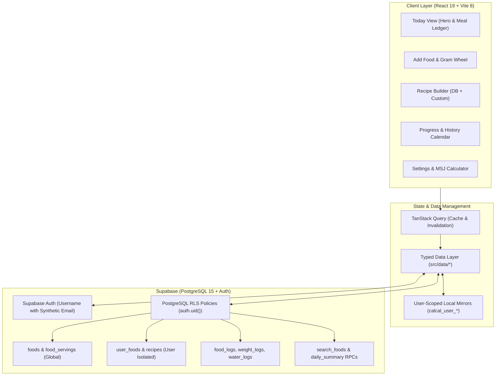

# CALCal 🥗

> **Production-grade calorie, macronutrient, and micronutrient tracker tailored for Indian dietary patterns and desi foods.**

[](https://react.dev/)
[](https://www.typescriptlang.org/)
[](https://vitejs.dev/)
[](https://tailwindcss.com/)
[](https://supabase.com/)
[](LICENSE)

---

## 🌟 Overview

**CALCal** is a high-performance, mobile-first nutritional ledger designed specifically for the complexities of Indian meals—where mixed curries, varied cooking fats (ghee, mustard oil), flour varieties (atta, ragi, jowar), and portion units (katoris, rotis, bowls) require flexibility and precision.

Built following the **Google Stitch `botanical_ledger_2`** aesthetic, CALCal pairs a linen-and-forest-green heritage look with modern interactive physics and strict data integrity.

---

## 📸 Key Features

### 1. 🍽️ Desi-First Food & Recipe Logging
- **Regional Fuzzy Search**: Trigram-powered search supporting aliases in Hindi, Tamil, Telugu, and English (e.g. *chana dal*, *palak paneer*, *dosa*).
- **Tactile Gram Wheel Adjuster**: Portions can be dialled in smoothly with an interactive scrubber (50g–600g), `±10g` nudges, and Indian household presets (*50g chutney*, *100g standard*, *150g 1 katori*, *200g 1 cup*, *250g 1 bowl/plate*).
- **Custom Recipe Builder**: Compose dishes using database ingredients and custom homemade items with specific macros and fiber. Calculates total cooked yield and per-serving nutrition dynamically.
- **Eyeball Quick Add**: Fast macro logging for home-cooked meals without barcode scanning.

### 2. 📊 Nutrients & Dynamic Magnitude Feedback
- **Calories Consumed Focal Readout**: Main hero metric highlights consumed energy alongside daily budget targets.
- **Four-Macro Tracking**: Live status bars for **Protein**, **Carbs**, **Fat**, and **Fiber**.
- **Magnitude-Based Color Transitions**:
  - `≤ 100%`: **Botanical Safe Green** (`#2d7a48`)
  - `101% - 120%`: **Amber Warning** (`#f59e0b`)
  - `> 120%`: **Crimson Danger** (`#c83939`)
- **10 Tracked Micronutrients**: Iron, Calcium, Vitamin B12, Vitamin C, Vitamin D, Zinc, Magnesium, Potassium, Folate, and Sodium with missing vs. zero distinction.

### 3. 🗓️ All-Days History Calendar
- Interactive monthly calendar with month navigation and `Today` jump button.
- Daily calorie pills with magnitude status dots and recorded weight flags.
- **Day Inspector**: Tap any day to inspect full calorie totals, macro split, logged dish list, and jump directly to that date.

### 4. 💧 Water Tracker & Biometrics
- **4000 ml Daily Water Goal**: One-tap `+250 ml glass` logging with persistent daily tracking.
- **Decoupled Biometrics**: Smooth weight entry (`±0.5 kg` steppers) and birth year selector (1948–2012) with instant synchronization across Settings and Progress screens.
- **Science-Backed Mifflin-St Jeor Engine**: Dynamic BMR & TDEE calculation with a strict 1200 kcal adult safety floor.

---

## 🏗️ System Architecture



### Architectural Principles:
1. **Zero Direct Supabase Calls in UI**: UI components consume custom hooks or the typed data layer (`src/data/`), maintaining clean separation of concerns.
2. **Strict Multi-Tenant User Isolation**:
   - Supabase Row-Level Security (`RLS`) restricts all table mutations by `auth.uid() = user_id`.
   - Local caches are isolated per account (`calcal_user_${userId}_*`), preventing data bleed across logins.
3. **Offline Resilience**: Reads pull from Supabase with graceful fallback to local user mirrors; writes update the server and mirror simultaneously.
4. **Client-Side Local Time Computing**: All dates are normalized to user local dates (`getLocalDate()`) using `en-CA` formatting (`YYYY-MM-DD`), preventing timezone shifts across midnight.

---

## 🎨 Design System: Botanical Ledger

CALCal implements the **Google Stitch `botanical_ledger_2`** design tokens, augmented with **UImaxxing** interaction primitives:

| Token | Value | Role |
| :--- | :--- | :--- |
| `--color-page-background` | `#e7dfcf` | Warm linen canvas background |
| `--color-card-background` | `#f0eadc` | Slightly elevated card surface |
| `--color-header-panel` | `#1f3a2b` | Deep forest green hero and navigation |
| `--color-action-primary` | `#7b2cff` | Electric purple (**strictly reserved for primary CTAs**) |
| `--color-status-safe` | `#2d7a48` | Target met / safe range |
| `--color-status-danger` | `#c83939` | High excess threshold (>120%) |
| `--color-amber-500` | `#f59e0b` | Moderate excess warning (101%–120%) |

### UImaxxing Interaction Primitives:
- `hover-raise` & `stroke-sheen`: Subtle elevation and ambient light sheen on cards.
- `hover-nudge`: Elastic micro-interaction physics on steppers and quick action chips.
- `caret-smooth`: Smooth caret transitions on decimal weight and portion inputs.
- `scroll-snappy` & `snap-x-list`: Momentum-based snapping for portion pills.
- `row-hover`: Active highlight transitions on logged food list items.

---

## 🗄️ Database Schema & Migrations

All migrations live under the `/db` directory:

- **`schema.sql`**: Initial tables (`foods`, `food_servings`, `food_logs`, `user_goals`) and trigram fuzzy search index.
- **`002_servings_and_dishes.sql`**: Custom user dishes, recipes, and serving conversions.
- **`003_users_progress.sql`**: User profiles, `weight_logs`, `water_logs`, favorites, and `daily_summary` RPC.
- **`004_fix_permissions.sql`**: Security definer grants for `anon` and `authenticated` roles.
- **`005_profiles_and_weight.sql`**: Adds `current_weight_kg` and `target_weight_kg` to `profiles` with bi-directional synchronization.

---

## 🚀 Getting Started

### Prerequisites
- **Node.js**: v18.0.0 or higher (v20+ recommended)
- **Package Manager**: `npm` or `pnpm`
- **Supabase Account**: With PostgreSQL project initialized

### 1. Clone & Install
```bash
git clone https://github.com/your-username/calcal.git
cd calcal
npm install
```

### 2. Environment Setup
Create a `.env` file in the project root:
```env
VITE_SUPABASE_URL=https://your-project.supabase.co
VITE_SUPABASE_ANON_KEY=your_publishable_anon_key
VITE_AUTH_EMAIL_DOMAIN=calcal.app
```

> **Note on Authentication**: Users sign up and sign in using **Username** and **Password** only. The application provisions a synthetic email under `VITE_AUTH_EMAIL_DOMAIN` behind the scenes. Ensure the **Email Provider** is enabled in your Supabase Auth dashboard with "Confirm email" toggled **OFF**.

### 3. Run Database Migrations
Execute the SQL files in order within your **Supabase SQL Editor**:
1. `schema.sql`
2. `profile.md` (or `003_users_progress.sql`)
3. `db/004_fix_permissions.sql`
4. `db/005_profiles_and_weight.sql`

### 4. Development Server
```bash
npm run dev
```
Open **`http://localhost:5173`** in your browser.

---

## 🧪 Testing & Verification

Run the test suite and production build verification:

```bash
# 1. Run unit tests (Recipe calculator nutrition scaling & micros logic)
node --test src/lib/recipe-calculator.test.mjs

# 2. Type-check with TypeScript
npx tsc -b

# 3. Production Vite build
npm run build
```

---

## 📁 Project Structure

```
calcal/
├── db/                        # Database migrations (001 - 005)
├── src/
│   ├── components/            # Reusable UI primitives (GramWheelAdjuster, Icon)
│   ├── data/                  # Typed Supabase API layer (auth, foods, goals, profile)
│   ├── features/              # Screen feature modules
│   │   ├── add-food/          # Food search, portions, quick add
│   │   ├── auth/              # Username/Password authentication screen
│   │   ├── progress/          # History calendar, weight trend, water intake
│   │   ├── recipes/           # Custom Recipe Builder (DB + Custom Ingredients)
│   │   ├── settings/          # Biometrics, Mifflin-St Jeor engine, goal edit
│   │   └── today/             # Main daily ledger, TodayHero, MicrosCard
│   ├── hooks/                 # TanStack Query hooks (food logs, goals, progress)
│   ├── lib/                   # Utilities, recipe calculation math, Supabase client
│   ├── types/                 # Database interfaces and domain types
│   ├── App.tsx                # React Router v7 routes and layout frame
│   ├── index.css              # Tailwind v4 theme, Botanical Ledger tokens
│   └── uimaxxing.css          # UImaxxing interaction engine & animations
├── components.json            # shadcn / UImaxxing registry configuration
├── package.json
└── vite.config.ts
```

---

## 📄 License

This project is licensed under the [MIT License](LICENSE).
